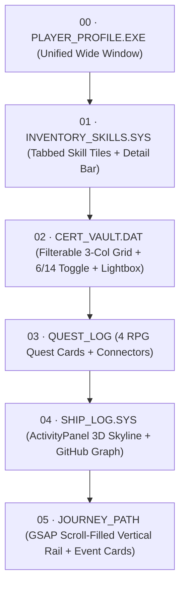

# About Page Overhaul — Retro OS + RPG Character Sheet

## Goal Description
Redesign [About.jsx](file:///c:/Users/ecomi/Desktop/portfolioJVRS--main/src/pages/About.jsx) and [About.css](file:///c:/Users/ecomi/Desktop/portfolioJVRS--main/src/pages/About.css) from plain floating plates and stacked lists into a cohesive **Retro OS Window + RPG Character Sheet** experience, powered by **GSAP ScrollTrigger** + stepped pixel animations. All existing data sources (`profile`, `skillGroups`, `troubleshooting`, `certifications`, `journey`, and `ActivityPanel`) remain intact while their layout, visual hierarchy, interactivity, and scroll motion are upgraded.

> [!NOTE]
> An interactive HTML preview mockup has been created alongside this plan:
> [about_overhaul_mockup.html](file:///C:/Users/ecomi/.gemini/antigravity/brain/28e8fe4f-dc68-42b5-b6ff-38b6f1e2d043/about_overhaul_mockup.html)

---

## Architecture & Section Flow

---

## Proposed Changes

### Reusable Retro Window Primitive
#### [MODIFY] [index.jsx](file:///c:/Users/ecomi/Desktop/portfolioJVRS--main/src/components/ui/index.jsx) & [primitives.css](file:///c:/Users/ecomi/Desktop/portfolioJVRS--main/src/styles/primitives.css)
- Add a lightweight `RetroWindow` component (`title`, `accent` world color, `footer` optional ticker slot, `children`) that uses existing `--card`, `--surface`, `--border`, and `--shadow-md` tokens so light/dark themes and `data-spray-surface="true"` continue to work seamlessly.

---

### Main About Hero (`PLAYER_PROFILE.EXE`)
#### [MODIFY] [About.jsx](file:///c:/Users/ecomi/Desktop/portfolioJVRS--main/src/pages/About.jsx) & [About.css](file:///c:/Users/ecomi/Desktop/portfolioJVRS--main/src/pages/About.css)
- Replace the floating translucent bio plates and dashed facts list with a **Unified Wide Retro OS Window**:
  - **Title bar:** `PLAYER_PROFILE.EXE — June Vic M. Abello` with pixel window controls (`_`, `□`, `×`) and sticky section jump pills above/inside.
  - **Left column:** Framed portrait (`/jv.png`) with `LVL 03 · BSCS` pixel badge + animated RPG focus stat bars (`WEB DEV`, `LOCAL AI`, `SYS / FIX`) that fill on enter.
  - **Right column:** `<h1>` title, bio prose, and a clean 2×2+1 quick-facts stat box grid (`School`, `Program`, `Year`, `Location`, `Status`).
  - **Bottom ticker bar:** Dark `--ink` status strip (`● STATUS: SHIPPING @ www.junevicabello.site` · `FOCUS: Local LLMs · UX · Creative Tools`).

---

### Section 01 — Skills (`INVENTORY_SKILLS.SYS`)
#### [MODIFY] [About.jsx](file:///c:/Users/ecomi/Desktop/portfolioJVRS--main/src/pages/About.jsx) & [About.css](file:///c:/Users/ecomi/Desktop/portfolioJVRS--main/src/pages/About.css)
- Wrap skills in a Retro OS Window with category filter tabs (`All`, `Frontend & Languages`, `AI / LLM`, `Backend & DevOps`, `Design & 3D`, `Editors`) mapped directly to `skillGroups`.
- Render `SkillTile` cards with stepped hover lift and click/hover selection.
- Replace floating absolute tooltips (which can clip on mobile/edges) with an **inline retro detail bar** at the bottom of the window showing the selected/hovered skill name, linked project badges, and usage count (`×N`), while preserving keyboard focus accessibility.

---

### Section 02 — Certificates (`CERT_VAULT.DAT`)
#### [MODIFY] [About.jsx](file:///c:/Users/ecomi/Desktop/portfolioJVRS--main/src/pages/About.jsx) & [About.css](file:///c:/Users/ecomi/Desktop/portfolioJVRS--main/src/pages/About.css)
- Add category classification helper in `About.jsx` (or optional `category` field in `certifications.js`) for filter tabs: `All (14)`, `AI` (Claude / OpenAI), `Security & Privacy` (Fortinet / DICT), `Web & Python` (Cisco), and `College & Gov` (Columban OJT / TechFest / DOLE SPES).
- Default to showing **6 certificates** in a crisp 3-column grid with a **"Show all 14 certificates"** retro toggle button to keep vertical scroll balanced.
- Keep click-to-zoom lightbox + `Verify` external link.

---

### Section 03 — Side Quests (RPG Quest Log)
#### [MODIFY] [About.jsx](file:///c:/Users/ecomi/Desktop/portfolioJVRS--main/src/pages/About.jsx) & [About.css](file:///c:/Users/ecomi/Desktop/portfolioJVRS--main/src/pages/About.css)
- Upgrade the 4 `troubleshooting` cards into **RPG Quest Log Cards** (`QUEST_01`–`QUEST_04`) with `UNLOCKED` status tags, pixel node connectors, and staggered GSAP ScrollTrigger entrance.

---

### Section 04 — Proof of Work (`SHIP_LOG.SYS`)
#### [MODIFY] [About.jsx](file:///c:/Users/ecomi/Desktop/portfolioJVRS--main/src/pages/About.jsx) & [About.css](file:///c:/Users/ecomi/Desktop/portfolioJVRS--main/src/pages/About.css)
- Wrap the existing `<ActivityPanel headingLevel="h3" />` inside a matching `RetroWindow` (`SHIP_LOG.SYS`) so the 3D Skyline and GitHub contribution graph integrate visually with the rest of the page without breaking any 3D canvas behavior.

---

### Section 05 — Journey (Animated Vertical Quest Path)
#### [MODIFY] [About.jsx](file:///c:/Users/ecomi/Desktop/portfolioJVRS--main/src/pages/About.jsx) & [About.css](file:///c:/Users/ecomi/Desktop/portfolioJVRS--main/src/pages/About.css)
- Convert `.journey` items into retro milestone cards along a vertical progress rail.
- Use **GSAP `ScrollTrigger`** (`scrub: true`) to animate the vertical progress bar fill as the user scrolls through the 10 milestones, with stepped card reveals and highlighted year pills + clickable project links (`to`).

---

### GSAP ScrollTrigger & Reduced-Motion Choreography
#### [MODIFY] [About.jsx](file:///c:/Users/ecomi/Desktop/portfolioJVRS--main/src/pages/About.jsx)
- Register `ScrollTrigger` from `gsap/ScrollTrigger` inside `useGSAP` (`@gsap/react`), scoped to the `.about` container ref for clean React unmount cleanup.
- Respect `window.matchMedia('(prefers-reduced-motion: reduce)')` via `gsap.matchMedia()` so users with reduced motion enabled see all sections immediately without scroll animations.
- Sound integration: keep existing `SoundContext` interactions compatible with new tabs and filter buttons.

---

## Verification Plan

### Automated Verification
- Run `npm run build` in `c:\Users\ecomi\Desktop\portfolioJVRS--main` to verify Vite bundling, CSS syntax, and zero import/JSX errors.

### Manual Verification
- Start dev server (`npm run dev`) and inspect `/about` in both **Light** and **Dark** themes at desktop (`1440px`), tablet (`768px`), and mobile (`375px`) widths:
  1. Confirm `PLAYER_PROFILE.EXE` window, portrait, stat bars, and ticker render cleanly without overflow.
  2. Test Skills category tabs and hover/click inline detail bar.
  3. Test Certificates filter tabs, `Show all 14` / `Collapse to 6` toggle, and lightbox modal (`Esc` + click close).
  4. Scroll through Side Quests, Proof of Work (`ActivityPanel`), and Journey to verify GSAP ScrollTrigger animations and vertical rail fill.
