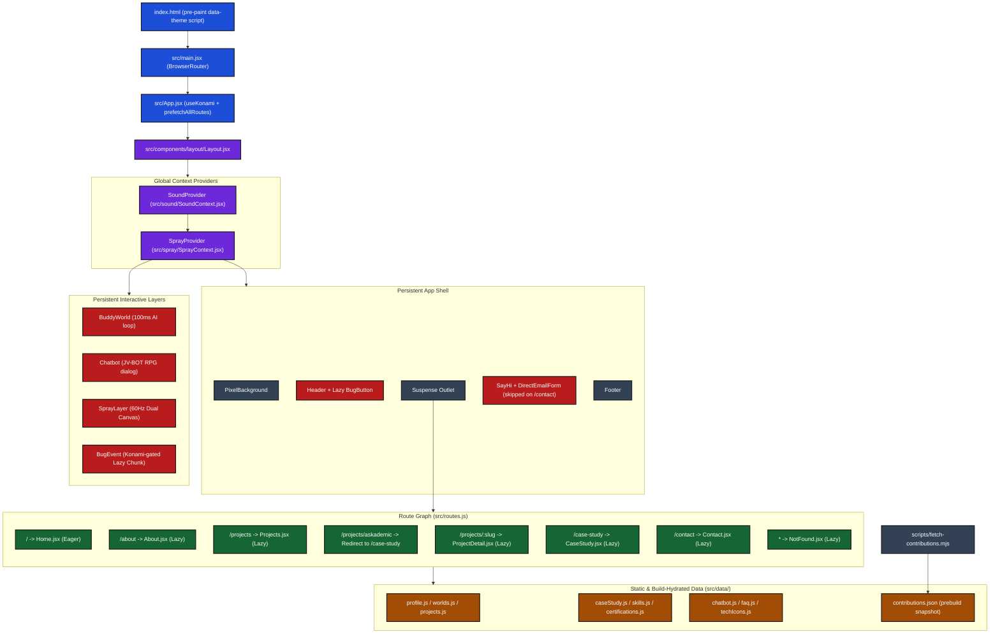
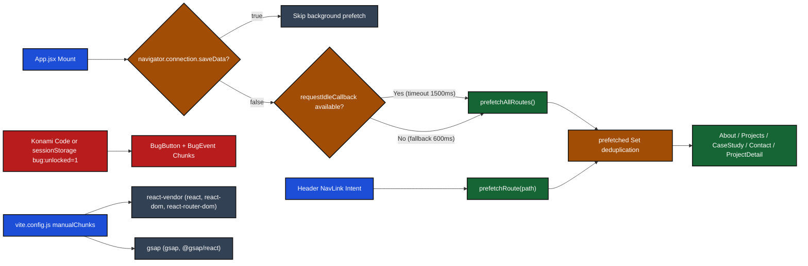
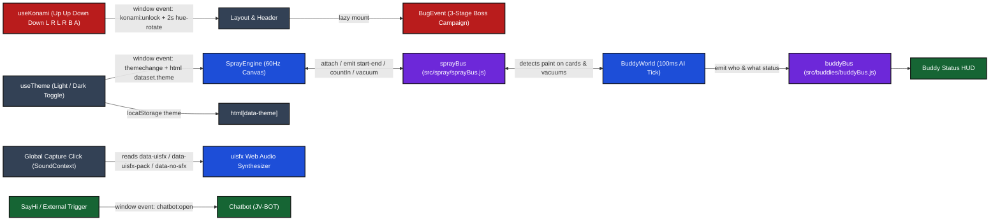
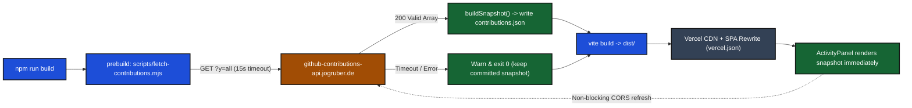

# June Vic M. Abello — Portfolio (`portfolio-jvrs` v0.5.0)

[](https://www.junevicabello.site)
[](https://react.dev/)
[](https://vitejs.dev/)
[](https://reactrouter.com/)
[](https://gsap.com/)
[](https://www.npmjs.com/package/uisfx)
[](https://www.emailjs.com/)
[](src/styles/tokens.css)

**Domain Color Worlds:**


Technical specification and architecture documentation for the personal developer portfolio of **June Vic M. Abello** (`BS Computer Science`, Gordon College). Built as a zero-backend React 18 + Vite 5 SPA styled around a 4 px pixel-grid design system (**Warm Paper & Charcoal Ink** light default + dark mode) with custom physics, procedural encoders, synthesized Web Audio, and build-time data hydration on Vercel.

---

## 1. System Architecture

The application separates **eager shell/home rendering**, **idle-prefetched route chunks**, **non-React simulation loops** (canvas spray physics, 100 ms pixel buddy AI, DOM boss fight), and **build-time GitHub snapshot hydration**.



---

## 2. Route Splitting, Bundle Chunking & Idle Prefetch


`Home.jsx` is bundled into the initial entry chunk for immediate First Contentful Paint. All secondary routes and `BugEvent.jsx` are code-split via `React.lazy` in [`src/routes.js`](src/routes.js) and [`vite.config.js`](vite.config.js).



### Route Matrix

| Route | Strategy | Page Module | Key Components & Subsystems | Primary Data Modules |
| :--- | :--- | :--- | :--- | :--- |
| `/` |  | `src/pages/Home.jsx` | `DotText`, `SkillKeys` (Web Audio keycaps), `BuddyFloor`, `WorldList` | `profile.js`, `projects.js` |
| `/about` |  | `src/pages/About.jsx` | `RetroType`, `Cartridge3D`, `PegBoard`, `SkillChains`, `ActivityPanel`, `PixelGadget` | `contributions.json`, `skills.js`, `certifications.js` |
| `/projects` |  | `src/pages/Projects.jsx` | Featured Askademic browser mockup card, `WorldList` grouped by world | `projects.js`, `worlds.js` |
| `/projects/askademic` |  | `Navigate` | Canonical client redirect to `/case-study` | `CASE_STUDY_SLUG` |
| `/projects/:slug` |  | `src/pages/ProjectDetail.jsx` | Project specs, `TagList`, team role breakdown, missing-slug 404 card | `projects.js`, `worlds.js` |
| `/case-study` |  | `src/pages/CaseStudy.jsx` | `useActiveSection` (`IntersectionObserver`), locker TOC (`CS-01`), lined notebook sheets (`01`-`08`) | `caseStudy.js`, `projects.js` |
| `/contact` |  | `src/pages/Contact.jsx` | Inline `SayHi`, `DirectEmailForm`, Developer ID card (`idCodes.js`), `Asia/Manila` clock | `profile.js`, `faq.js` |
| `*` |  | `src/pages/NotFound.jsx` | Retro "Game over" screen with decorative `9 -> 0` countdown | — |

---

## 3. Cross-Module Event Buses & Interactive Subsystems

High-frequency visual and audio subsystems bypass React re-renders by communicating through plain-JS pub/sub buses (`sprayBus`, `buddyBus`) and `window` `CustomEvent` channels.



### Subsystem Engineering Specs

| Subsystem | Module | Color Tag | Technical Implementation Details |
| :--- | :--- | :--- | :--- |
| **Spray Physics Engine** | `src/spray/engine.js` |  | Plain JS dual-canvas renderer stored in document coordinates. Fixed timestep `STEP = 1000/60`, 4-iteration Verlet/rope constraint solver (`SEG = 6`), bounded buffers (`MAX_STRAND = 700`, `MAX_STRANDS = 40`, `MAX_POINTS = 3200`, `MAX_DOTS = 4000`, `MAX_PARTICLES = 900`, `MAX_LETTERS = 400`), auto-sleep (`SLEEP_SPEED = 0.06` for `40` frames). Supports 5 modes (`string`, `paint`, `sand`, `confetti`, `letters`), 5 flow presets (`balanced`, `curly`, `heavy`, `floaty`, `chaos`), 4 nozzle sprites (`classic`, `graffiti`, `marker`, `crosshair`), 4 palettes (`section`, `neon`, `ink`, `print`), and static reduced-motion placement. |
| **Pixel Buddy Simulation** | `src/buddies/BuddyWorld.jsx` |  | Autonomous agents (**June Vic** `48 px` wide, **Claude** `36 px` wide at `SCALE = 3`) walking at `3 px/tick` and running at `8 px/tick` across `[data-spray-surface]` card boundaries. Evaluates date/time-aware dialogue (`today()`, `timeOfDay()`), picks up paint coordinates via `sprayBus.countIn()`, and triggers vacuum cleanup via `sprayBus.vacuum()`. |
| **Procedural Barcode & QR** | `src/components/layout/idCodes.js` |  | Pure-JS **Code 128B** generator (`encodeCode128B`, start code `104`, mod-103 checksum, stop `106`) paired with a **stylized ECC Level H QR generator** featuring connected rounded modules, custom finder eyes, and center badge rendered onto the Developer ID card in `SayHi.jsx`. |
| **Dot-Matrix Portrait** | `src/dotmatrix/DotPortrait.jsx` |  | Crops `411x411` portrait to 4:5 (`41, 0, 329x411`) and executes a stack-based flood fill seeded **only from top and side edges** (`r,g,b > 214`, chroma `< 26`) to clear studio white backgrounds while preserving the white shirt collar between lapels. |
| **Web Audio UI SFX** | `src/sound/SoundContext.jsx` |  | Wraps `uisfx` with first-gesture audio unlock, capture-phase DOM click delegation (`[data-uisfx]`, `[data-uisfx-pack]`, `[data-no-sfx]`), preloads 5 packs (`mechanical`, `minimal`, `studio`, `arcade`, `scifi`), and persists volume/mute in `localStorage['portfolio-jvrs:uisfx']`. |
| **Bug Attack Boss Fight** | `src/bugEvent/BugEvent.jsx` |  | Konami-gated lazy chunk (`GRAVITY = 1900`). Three bosses mapped to real portfolio projects (`Error403` / `jv-ytdlp`, `Hallucination` / `GC-Assist`, `RollbackKing` / `Askademic`) with combo mechanics, Last Stand sequence, non-destructive overlay FX, and clean DOM restoration on victory or retreat. |
| **GitHub Activity Views** | `src/activity/ActivityPanel.jsx` |  | Dual visualization (`Heatmap2D.jsx` + `Skyline3D.jsx`). Auto-defaults to `2d` on `<= 640px` viewports and `3d` on desktop, persisted via `localStorage['activity-view']`. |
| **JV-BOT Dialog Widget** | `src/widgets/Chatbot.jsx` |  | Scripted retro RPG dialog box (`TYPE_MS = 16`, `THINK_MS = 380`) with `12x12` crisp-edge SVG avatar (`BotPortrait`), quick-action chips, and instant text render under `prefers-reduced-motion`. |

---

## 4. Direct Email Delivery & Validation Pipeline


[`DirectEmailForm.jsx`](src/components/layout/DirectEmailForm.jsx) validates input client-side, filters automated submissions with a hidden `website` honeypot field, and gracefully degrades to a pre-filled Gmail compose URL whenever `VITE_EMAILJS_*` environment variables are absent or the upstream API rejects.

```mermaid
sequenceDiagram
  autonumber
  participant V as Visitor (Browser)
  participant F as DirectEmailForm.jsx
  participant EJS as EmailJS REST API
  participant GM as Gmail Compose

  V->>F: Submit Name, Email, Message (+ hidden honeypot)
  alt Honeypot "website" is non-empty
    F-->>V: Silently abort submission
  else Empty required fields
    F-->>V: Show validation alert ("Please fill in your name, email, and message.")
  else Invalid format (!EMAIL_RE)
    F-->>V: Show validation alert ("Please enter a valid email address.")
  else Valid payload & VITE_EMAILJS_* env vars configured
    F->>EJS: POST /api/v1.0/email/send (service_id, template_id, user_id, dual template_params)
    alt HTTP 200 OK
      EJS-->>F: 200 OK
      F-->>V: Clear inputs + show sent confirmation
    else Network or HTTP error
      EJS-->>F: Error response
      F-->>V: Show error + pre-filled "Open in Gmail" link (buildGmailUrl)
    end
  else Valid payload & VITE_EMAILJS_* env vars unset
    F->>GM: window.open(buildGmailUrl) with su + body pre-filled
    F-->>V: Show fallback notice + keep pre-filled "Open in Gmail" link
  end
```



---

## 5. Build Pipeline, GitHub Data Hydration & Vercel CDN


`npm run build` executes `scripts/fetch-contributions.mjs` before bundling so the GitHub activity heatmap/skyline always renders immediately at zero network cost, while silently falling back to the committed [`src/data/contributions.json`](src/data/contributions.json) if the third-party API times out (`15000 ms`).



### Vercel HTTP Caching & Routing Rules (`vercel.json`)

| Pattern | Directive | Purpose |
| :--- | :--- | :--- |
| `/assets/(.*)` | `public, max-age=31536000, immutable` | Permanent caching for content-hashed Vite JS/CSS chunks |
| `/projects/(.*)` | `public, max-age=604800, stale-while-revalidate=86400` | 7-day edge/browser cache with 24 h background revalidation for project media |
| `/(.*)\\.(webp\|jpg\|jpeg\|png\|svg\|woff2)` | `public, max-age=604800, stale-while-revalidate=86400` | Long-lived caching for static images, icons, and fonts |
| `/(.*)` | Rewrite `-> /index.html` | Client-side React Router deep-link support (`/about`, `/projects/:slug`, `/case-study`, `/contact`) |

---

## 6. Design System & Color Tokens (`src/styles/tokens.css`)

Light mode (**Warm Paper & Charcoal Ink**) is the default; dark mode activates via `[data-theme="dark"]` on `<html>`, initialized synchronously in `index.html` before first paint to eliminate theme flash.

### World Accents & Fixed Ink

| Token | Light Mode | Dark Mode | Role |
| :--- | :--- | :--- | :--- |
| `--world-code` |  |  | `01 · Code` badge, eyebrow, spray & progress accents |
| `--world-create` |  |  | `02 · Create` badge, error left-border & creative accents |
| `--world-learn` |  |  | `03 · Learn` badge & study/experiment accents |
| `--world-fg` / `--ink` |   |   | High-contrast world label ink & fixed pixel outline ink |

### Surface, Text & Interactive Palette

| Token | Light Mode (`:root`) | Dark Mode (`[data-theme='dark']`) | Contrast / Usage |
| :--- | :--- | :--- | :--- |
| `--bg` |  |  | Base page canvas |
| `--fg` |  |  | Primary body & heading ink |
| `--card` |  |  | Elevated pixel-card background |
| `--surface` |  |  | Secondary control / feedback surface |
| `--muted-fg` |  |  | Labels & metadata (~8.2:1 light / ~6.8:1 dark on `--card`) |
| `--primary` |  |  | Links, primary buttons (6.7:1 light / 7.4:1 dark) |
| `--primary-soft` |  |  | Active accents & spray primary tone |
| `--primary-fg` |  |  | Text on `--primary` buttons |
| `--border` |  |  | Hard `4px` pixel borders |
| `--hairline` |  |  | Dashed rules & subtle dividers |
| `--focus` |  |  | `3px` `:focus-visible` outline |

### Typography & Geometry Tokens

- **Fonts**: `'Press Start 2P'` (`--font-pixel`, headings/labels >= 16 px), `'VT323'` (`--font-ui`, tags/nav/controls), `'Space Grotesk'` (`--font-prose`, body copy at `1.0625rem` / `68ch` measure)
- **Pixel Grid**: `--px: 4px`, `--radius: 0`, `--border-w: 4px`, `--shadow-sm: 4px 4px 0 0 var(--shadow-color)`, `--shadow-md: 8px 8px 0 0 var(--shadow-color)`
- **Stepped Motion**: `--step-ease: steps(5, end)`, `--dur: 200ms`
- **Container Max Width**: `--max-w: 1760px` with responsive gutter `clamp(16px, 4vw, 72px)`

---

## 7. Portfolio Content Inventory (`src/data/projects.js`)

| World | Slug | Title | Summary |
| :--- | :--- | :--- | :--- |
|  | `askademic` | **Askademic** | Faculty Appointment & Consultation System (featured at `/case-study`) |
|  | `gc-assist` | **GC-Assist** | AI-Powered Conversational Information System for Gordon College |
|  | `jalgorithm` | **JALgorithm** | ML chatbot for salon appointment booking & reminders |
|  | `jv-ytdlp` | **jv-ytdlp** | Browser-based desktop video downloader powered by `yt-dlp` |
|  | `twitchchat-sim` | **TwitchChat Sim** | AI-powered Twitch chat simulator for testing & streaming practice |
|  | `state-and-effect` | **State and Effect** | Interactive React lesson deck on state, re-rendering & `useEffect` |
|  | `prompt-engineering` | **System Prompt Library** | Personas and prompt templates for local LLMs |
|  | `graphics` | **UI & Graphics** | Mockups and visual assets |
|  | `video-editing` | **Video Editing & Motion** | CapCut edits, project demos & short-form video cuts |
|  | `3d-modeling` | **3D Modeling & Renders** | Blender & Prisma3D scenes, props & visual experiments |
|  | `bscs-gordon-college` | **BS Computer Science** | Gordon College, Olongapo City |
|  | `local-llm-lab` | **Local LLM Lab** | Running and integrating models on local hardware (LM Studio) |
|  | `linux-cybersecurity` | **Linux & Cybersecurity** | Hands-on Linux administration, networking & security basics |
|  | `ai-agents-automation` | **AI Agents & Automation** | Tool-using agents, MCP servers & `n8n` workflows |

---

## 8. Repository Structure

```text
portfolioJVRS--main/
├── index.html                        # Entry HTML, Google Fonts & pre-paint theme script
├── package.json                      # Dependencies & npm scripts (dev, prebuild, build, preview)
├── vite.config.js                    # Vite + manualChunks (react-vendor, gsap)
├── vercel.json                       # Edge Cache-Control headers & SPA rewrite
├── scripts/
│   └── fetch-contributions.mjs       # Build-time GitHub activity fetcher (graceful offline fallback)
├── public/
│   ├── assets/tech/                  # Tech stack SVG/PNG icons & LICENSES.txt
│   ├── assets/ui/kenney-pixel-ui/    # CC0 pixel UI sprites
│   ├── audio/bug-hero.mp3            # Bug Attack stage soundtrack
│   └── projects/                     # Cover media, Askademic screenshots & personas
└── src/
    ├── main.jsx                      # ReactDOM root & BrowserRouter mount
    ├── App.jsx                       # Route table, Konami listener & idle route prefetcher
    ├── routes.js                     # Centralized lazy imports & Save-Data-aware prefetching
    ├── activity/                     # GitHub ActivityPanel, Heatmap2D, Skyline3D & stats.js
    ├── buddies/                      # BuddyWorld, Buddy, PixelSprite, sprites.js & buddyBus.js
    ├── bugEvent/                     # Konami-gated BugButton, 3-stage BugEvent, sprites & audio
    ├── components/
    │   ├── layout/                   # Layout, Header, Footer, SayHi, DirectEmailForm, idCodes, PixelBackground
    │   ├── showcase/                 # Cartridge3D, PegBoard, PixelGadget, RetroType, SkillChains, SkillKeys, WorldList
    │   └── ui/                       # Shared PixelButton, PixelCard, Eyebrow, SectionHeading, TagList, Reveal
    ├── data/                         # Structured portfolio content & contributions.json snapshot
    ├── dotmatrix/                    # DotField, DotPortrait (flood-fill mask) & DotText
    ├── hooks/                        # useKonami, useScrollToTop, useTheme
    ├── pages/                        # Home, About, Projects, ProjectDetail, CaseStudy, Contact, NotFound
    ├── sound/                        # SoundContext & uisfx Web Audio preload/delegation
    ├── spray/                        # SprayEngine (60Hz canvas physics), sprayBus, SprayLayer, SprayPanel
    ├── styles/                       # tokens.css, base.css, primitives.css, layout.css, index.css
    └── widgets/                      # Chatbot (JV-BOT) & NowPlaying
```

---

## 9. Local Development & Environment Variables

### Commands

```bash
npm install      # Install dependencies
npm run dev      # Start Vite dev server (HMR)
npm run build    # Run prebuild GitHub snapshot + Vite production bundle -> dist/
npm run preview  # Preview production dist/ locally
```

### Optional Environment Variables (`.env` / Vercel)

| Variable | Required | Default Behavior When Unset | Purpose |
| :--- | :--- | :--- | :--- |
| `VITE_EMAILJS_SERVICE_ID` | No | Falls back to pre-filled Gmail compose | EmailJS service identifier for `DirectEmailForm` |
| `VITE_EMAILJS_TEMPLATE_ID` | No | Falls back to pre-filled Gmail compose | EmailJS template identifier (`from_name`, `from_email`, `reply_to`, `message`, `to_email` + `name`, `email`, `title`) |
| `VITE_EMAILJS_PUBLIC_KEY` | No | Falls back to pre-filled Gmail compose | EmailJS public API key (`user_id`) |

> **Security note:** `.env` and `.env.*` are gitignored in [`.gitignore`](.gitignore). Add the three `VITE_EMAILJS_*` variables in **Vercel Project Settings -> Environment Variables** when deploying direct in-page mail delivery.

---

## 10. Links

- **Website:** https://www.junevicabello.site
- **GitHub:** https://github.com/EcomineAI
- **LinkedIn:** https://www.linkedin.com/in/june-vic-abello-82a1683b7/
- **Email:** junevicabello@gmail.com
