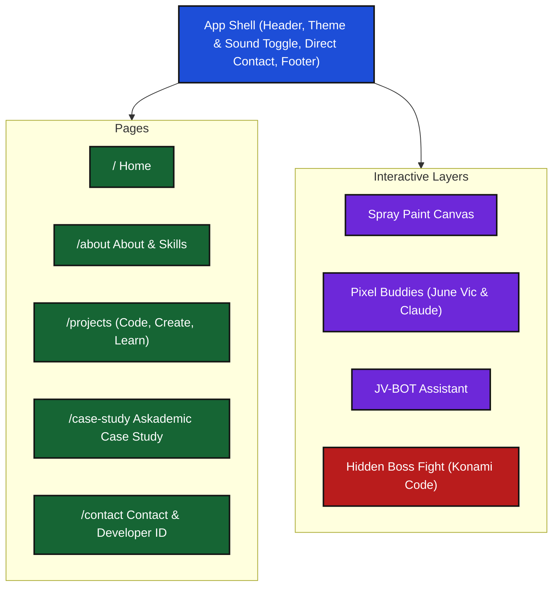
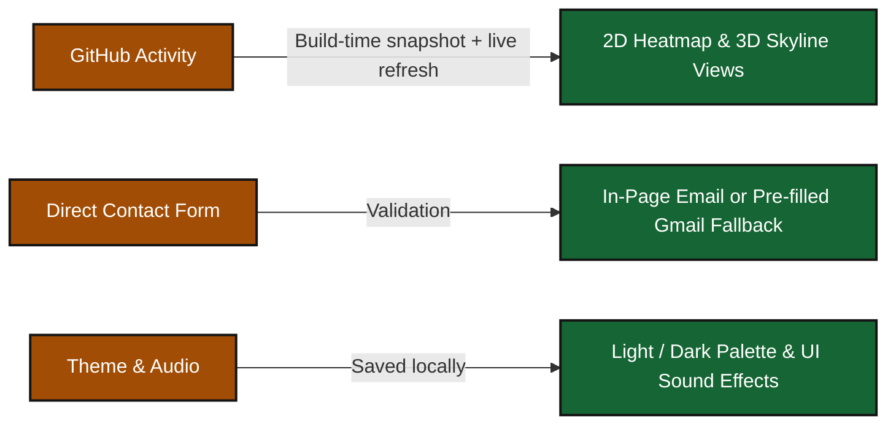

# June Vic M. Abello — Portfolio

[](https://www.junevicabello.site)
[](https://react.dev/)
[](https://vitejs.dev/)
[](https://reactrouter.com/)
[](https://gsap.com/)
[](https://vercel.com/)

**Three Worlds:**


Personal developer portfolio of **June Vic M. Abello**, a BS Computer Science student at Gordon College. Built with React and Vite in a retro pixel-art style with light and dark modes, interactive animations, and playful extras across every page.

---

## Portfolio Overview



---

## Features & Data Flow



---

## Pages

| Route | Tag | What Visitors See |
| :--- | :--- | :--- |
| `/` |  | Dot-matrix intro, interactive skill keycap board, roaming buddies, and featured work |
| `/about` |  | Background, skills pegboard & chains, certifications, GitHub activity, and timeline |
| `/projects` |  | Featured Askademic showcase and all work grouped into Code, Create, and Learn |
| `/case-study` |  | Askademic software engineering & UX walkthrough with sticky notebook navigation |
| `/contact` |  | Developer ID card with scannable LinkedIn QR, direct email form, links, and FAQ |
| `404` |  | Retro "Game over" screen for unknown routes |

---

## Interactive Highlights

| Feature | Tag | Description |
| :--- | :--- | :--- |
| **Spray Paint Mode** |  | 5 modes (silly string, paint, sand, confetti, letters), custom nozzles & color palettes |
| **Pixel Buddies** |  | Animated June Vic & Claude sprites roaming cards and vacuuming up spray paint |
| **GitHub Activity** |  | Switchable 2D contribution heatmap and 3D skyline |
| **Developer ID Card** |  | Interactive ID card with scannable LinkedIn QR code and pixel barcode |
| **JV-BOT** |  | Retro RPG-style portfolio chat assistant |
| **UI Sound Effects** |  | Toggleable retro web audio feedback across buttons and interactive keys |
| **Konami Easter Egg** |  | Hidden 3-stage pixel boss fight across the live page |

---

## Color Palette & Typography

**Fonts:** `Press Start 2P` (headings), `VT323` (UI labels & tags), `Space Grotesk` (body copy)

| Role | Light Mode (Warm Paper) | Dark Mode | Usage |
| :--- | :--- | :--- | :--- |
| **01 · Code** |  |  | Engineering projects & badges |
| **02 · Create** |  |  | Creative work & alerts |
| **03 · Learn** |  |  | Study, labs & experiments |
| **Background** |  |  | Page canvas |
| **Card Surface** |  |  | Elevated pixel cards |
| **Primary Text** |  |  | Headings & body ink |
| **Accent** |  |  | Links, buttons & focus states |

---

## Featured Work by World

| World | Project | Overview |
| :--- | :--- | :--- |
|  | **Askademic** | Faculty Appointment & Consultation System (featured at `/case-study`) |
|  | **GC-Assist** | AI-Powered Conversational Information System for Gordon College |
|  | **JALgorithm** | ML chatbot for salon appointment booking & reminders |
|  | **jv-ytdlp** | Browser-based desktop video downloader powered by `yt-dlp` |
|  | **TwitchChat Sim** | AI-powered Twitch chat simulator for testing & streaming practice |
|  | **State and Effect** | Interactive React lesson deck on state, re-rendering & `useEffect` |
|  | **System Prompt Library** | Personas and prompt templates for local LLMs |
|  | **UI & Graphics** | Mockups and visual assets |
|  | **Video Editing & Motion** | CapCut edits, project demos & short-form video cuts |
|  | **3D Modeling & Renders** | Blender & Prisma3D scenes, props & visual experiments |
|  | **BS Computer Science** | Gordon College, Olongapo City |
|  | **Local LLM Lab** | Running and integrating open models on local hardware |
|  | **Linux & Cybersecurity** | Hands-on Linux administration, networking & security basics |
|  | **AI Agents & Automation** | Tool-using agents, MCP servers & `n8n` workflows |

---

## Project Structure

```text
├── public/               # Static media, project covers, tech icons & audio
├── scripts/              # Build-time GitHub contributions snapshot fetcher
└── src/
    ├── pages/            # Route pages (Home, About, Projects, CaseStudy, Contact, 404)
    ├── components/       # Layout shell, Developer ID card, Email form & UI primitives
    ├── data/             # Profile, projects, skills, case study & FAQ content
    ├── styles/           # Design tokens, base styles & responsive layout rules
    ├── activity/         # 2D GitHub heatmap & 3D skyline views
    ├── buddies/          # Roaming pixel sprites (June Vic & Claude)
    ├── bugEvent/         # Konami-unlocked boss fight easter egg
    ├── dotmatrix/        # Dot-matrix text & portrait canvas effects
    ├── sound/            # Toggleable retro UI sound effects
    ├── spray/            # Interactive spray paint canvas
    └── widgets/          # JV-BOT assistant & Now Playing widget
```

---

## Links

- **Website:** https://www.junevicabello.site
- **GitHub:** https://github.com/EcomineAI
- **LinkedIn:** https://www.linkedin.com/in/june-vic-abello-82a1683b7/
- **Email:** junevicabello@gmail.com
